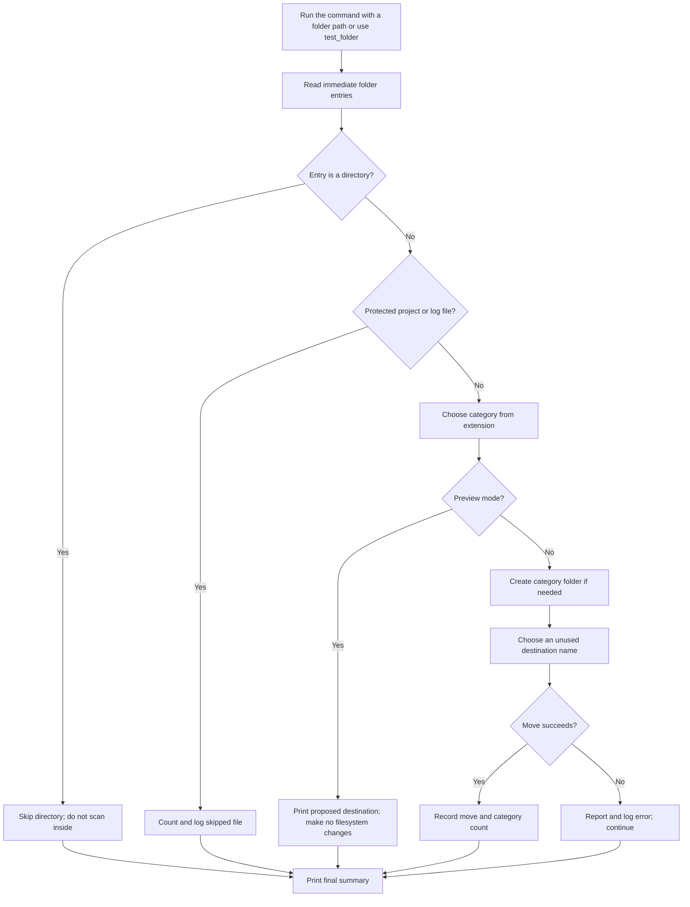

# Smart File Organizer

> A Python command-line tool for sorting top-level files by extension, previewing changes, and recording organization results.

## Table of contents

- [Project overview](#project-overview)
- [What the system does](#what-the-system-does)
- [System workflow](#system-workflow)
- [Technology stack](#technology-stack)
- [Project structure](#project-structure)
- [Prerequisites](#prerequisites)
- [Installation and setup](#installation-and-setup)
- [Usage](#usage)
- [Example output](#example-output)
- [Testing and verification](#testing-and-verification)
- [Safety and design considerations](#safety-and-design-considerations)
- [Limitations](#limitations)
- [Future enhancements](#future-enhancements)

## Project overview

Smart File Organizer sorts files from one selected folder level into category folders such as `Images`, `PDFs`, and `Documents`. It is a small, local command-line utility intended for people who want to tidy a folder without installing third-party Python packages.

Mixed file types can make folders such as Downloads difficult to browse. This project uses each file's extension to place supported types into predictable folders. Users can preview proposed destinations before running an organization operation.

## What the system does

The organizer scans only the immediate contents of the supplied folder. Its current extension mapping is:

| Category | Supported extensions |
| --- | --- |
| Images | `.jpg`, `.jpeg`, `.png` |
| PDFs | `.pdf` |
| Music | `.mp3` |
| Videos | `.mp4` |
| Documents | `.docx`, `.txt` |
| Others | Any other extension, or no extension |

During an actual run, it creates the needed category folder and moves each eligible file there. If the destination name is already taken, it chooses a suffix such as `_1` or `_2`. Files that cause a filesystem error are reported, and processing continues with the next entry.

Preview mode prints each proposed path and a category summary without creating category folders, moving files, or creating or updating the log. An actual run prints a summary of scanned, organized, skipped, and failed items, with counts by category. It also records successful moves, skipped entries, and errors in `organizer.log` by default.

## System workflow



For a readable target, the command takes a non-recursive listing, skips directories and protected files, classifies the remaining filenames, and either previews or moves them. Folder access errors are reported before scanning; per-file errors do not stop later files from being processed.

## Technology stack

| Area | Technology |
| --- | --- |
| Language | Python 3 |
| Command-line arguments | `argparse` |
| File operations | `os`, `shutil` |
| Activity log | `logging` |
| Automated tests | Python `unittest` |

The application and test suite use Python's standard library. No third-party packages are required. The source uses f-strings, introduced in Python 3.6 ([Python 3.6 release notes](https://docs.python.org/3/whatsnew/3.6.html#pep-498-formatted-string-literals)), so Python 3.6 is the minimum implied by its syntax; use a currently supported Python 3 release where possible.

## Project structure

```text
smart-file-organizer/
├── .git/                         # Git repository metadata
├── .gitignore                    # Ignores environments, caches, logs, and test artifacts
├── README.md                     # Project documentation
├── organizer.py                  # CLI, categorization, file moves, summary, and logging
├── test_folder/                  # Existing sample folders and files
│   ├── Documents/
│   │   └── assignment.docx
│   ├── Images/
│   │   ├── frog wallpaper.jpeg
│   │   └── WhatsApp Image 2026-08-04 at 111439 PM.jpg
│   ├── Music/
│   │   └── songs.mp3
│   ├── PDFs/
│   │   └── notes.pdf
│   └── Videos/
│       └── movie.mp4
└── tests/
    └── test_organizer.py         # Automated tests using temporary directories
```

`organizer.log` is created in the current working directory during an actual run unless another path is supplied. It is not present in the project tree until the application writes it.

## Prerequisites

- Python 3.6 or newer; a currently supported Python 3 release is recommended.
- Git, if cloning the repository.
- Windows PowerShell commands are shown below. The application itself uses Python's standard library.

## Installation and setup

Clone the repository and enter the project directory:

```powershell
git clone https://github.com/nih803/smart-file-organizer.git
Set-Location smart-file-organizer
```

Create and activate a virtual environment:

```powershell
python -m venv .venv
.\.venv\Scripts\Activate.ps1
```

There are no third-party dependencies to install. If you do not want to activate the environment, call its Python executable directly:

```powershell
& .\.venv\Scripts\python.exe --version
```

## Usage

From the project directory, show the available command-line options:

```powershell
python organizer.py --help
```

The supported arguments are:

| Argument | Description |
| --- | --- |
| `folder` | Optional target folder. Defaults to `test_folder`. |
| `--dry-run` | Preview proposed destinations without changing files or writing a log. |
| `--log-file PATH` | Choose the log path for an actual organization run. Defaults to `organizer.log` in the current working directory. |
| `-h`, `--help` | Display command help. |

Preview a folder first:

```powershell
python organizer.py "C:\Users\Alex\Downloads" --dry-run
```

Run the organizer on a selected folder after reviewing the preview:

```powershell
python organizer.py "C:\Users\Alex\Downloads"
```

Run against the bundled sample folder explicitly:

```powershell
python organizer.py ".\test_folder" --dry-run
```

A run without `--dry-run` moves files. The default folder remains `test_folder` for compatibility with the existing script. The tool does not ask for a second confirmation before moving files, so check the target path and preview output first.

## Example output

The following illustrative preview uses two files in a separate target folder. Exact paths and file counts depend on the folder being scanned.

```text
PS> python organizer.py "C:\Users\Alex\Downloads" --dry-run
PREVIEW: holiday.jpg -> C:\Users\Alex\Downloads\Images\holiday.jpg (Images)
PREVIEW: notes.pdf -> C:\Users\Alex\Downloads\PDFs\notes.pdf (PDFs)

SMART FILE ORGANIZER - REPORT
Mode: Preview (no changes made)
Files scanned: 2
Files organized: 0
Files planned: 2
Files skipped: 0
Directories skipped: 0
Failed operations: 0
Proposed files by category:
  Images: 1
  PDFs: 1
  Music: 0
  Videos: 0
  Documents: 0
  Others: 0
```

An actual run prints a summary without a per-file success line; successful moves are recorded in the log:

```text
PS> python organizer.py "C:\Users\Alex\Downloads"

SMART FILE ORGANIZER - REPORT
Mode: Organization complete
Files scanned: 2
Files organized: 2
Files skipped: 0
Directories skipped: 0
Failed operations: 0
Files organized by category:
  Images: 1
  PDFs: 1
  Music: 0
  Videos: 0
  Documents: 0
  Others: 0
```

## Testing and verification

Run the automated tests from the project directory:

```powershell
python -m unittest discover -s tests -v
```

The suite uses `tempfile.TemporaryDirectory`; it does not organize the bundled sample folder or personal folders. It covers all supported extensions (including uppercase extension matching), unknown and extensionless files, duplicate destinations, preview behavior, category and summary counts, logs, move and folder access errors, empty or missing folders, log-file protection, and non-recursive directory handling.

The current suite contains 11 tests. During this README review, all 11 passed on Python 3.14.0 with resource warnings treated as errors. Syntax checks and `git diff --check` also passed.

## Safety and design considerations

- **Destination conflicts:** The organizer checks whether a destination path already exists and selects a suffixed name. Tests confirm that files already at the destination remain unchanged.
- **Non-recursive scanning:** It examines only the supplied folder's immediate entries. Directories are skipped; their contents are not scanned.
- **Preview mode:** `--dry-run` prints proposed paths and counts. It does not create destination folders, move files, or create/update the log.
- **Filesystem errors:** Missing, inaccessible, and non-folder targets are reported. A failed individual move is counted and logged, and later entries are still processed.
- **Activity log:** Actual runs write timestamps, successes, skips, and errors to the selected log path. Preview runs do not write logs.
- **Protected entries:** Directories, Python source files (`.py`), `README.md`, `.gitignore`, and the configured log file are skipped. Other unsupported file types are eligible for `Others`.

## Limitations

- Categorization uses filename extensions only; it does not inspect file contents.
- Only the listed extension types have dedicated categories. Other files go to `Others`.
- Nested folders are not organized.
- Destination checks are repeated before a move, but the application does not coordinate with other processes that might write into the same target at the same time.
- There is no desktop interface or packaged executable in the current project.
- No license file is currently present in the repository.

## Future enhancements

These are plans, not implemented features:

### Phase 2: Desktop interface

- Build a Tkinter desktop GUI.
- Add a folder selection dialog.
- Show a visual file preview.
- Add a progress indicator during organization.

### Phase 3: Windows packaging

- Package the command-line application as a Windows executable using PyInstaller.
